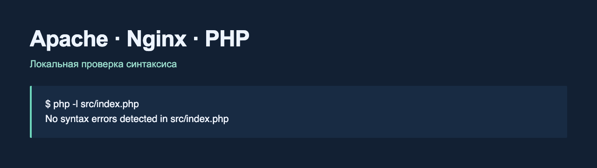
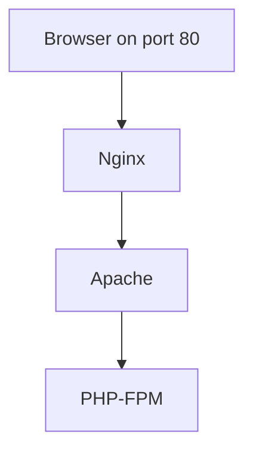

# Apache, Nginx and PHP · Compose Lab

A 2018 Docker Compose exercise with Nginx in front of Apache and a separate PHP-FPM container. It demonstrates a shared document root and request routing between three services.

[Demo](#demo) · [Repository map](#repository-map) · [PDF slides](docs/readme/overview.pdf) · [AGENTS.md](AGENTS.md)

## Demo



Local PHP syntax check of the sample endpoint. The container stack requires a compatible isolated lab.

1. Inspect the Compose service list and Nginx upstream configuration.
2. For an HTTP demo, run the stack inside an isolated lab VM.
3. Request /index.html and /index.php and compare the responses.

## How it works



## Repository map

| File or directory | Purpose |
| --- | --- |
| [`docker-compose.yml`](docker-compose.yml) | Three services, ports and shared source mounts |
| [`nginx/nginx.conf`](nginx/nginx.conf) | Static routes and upstream routing |
| [`httpd/httpd.conf`](httpd/httpd.conf) | Apache document root and PHP handler |
| [`src/index.php`](src/index.php) | Example PHP entry point |

## Inspect and run the lab

```sh
php -l src/index.php
docker compose config --services
```

On an isolated VM with a compatible Docker installation and port 80 free, run `docker compose up -d`. Try `curl -fsS http://127.0.0.1/index.php`, then stop the stack with `docker compose down`. The pinned Nginx 1.13 and PHP 7.2 images are historical. The sample PHP endpoint exposes configuration information, so keep the VM off public networks.
